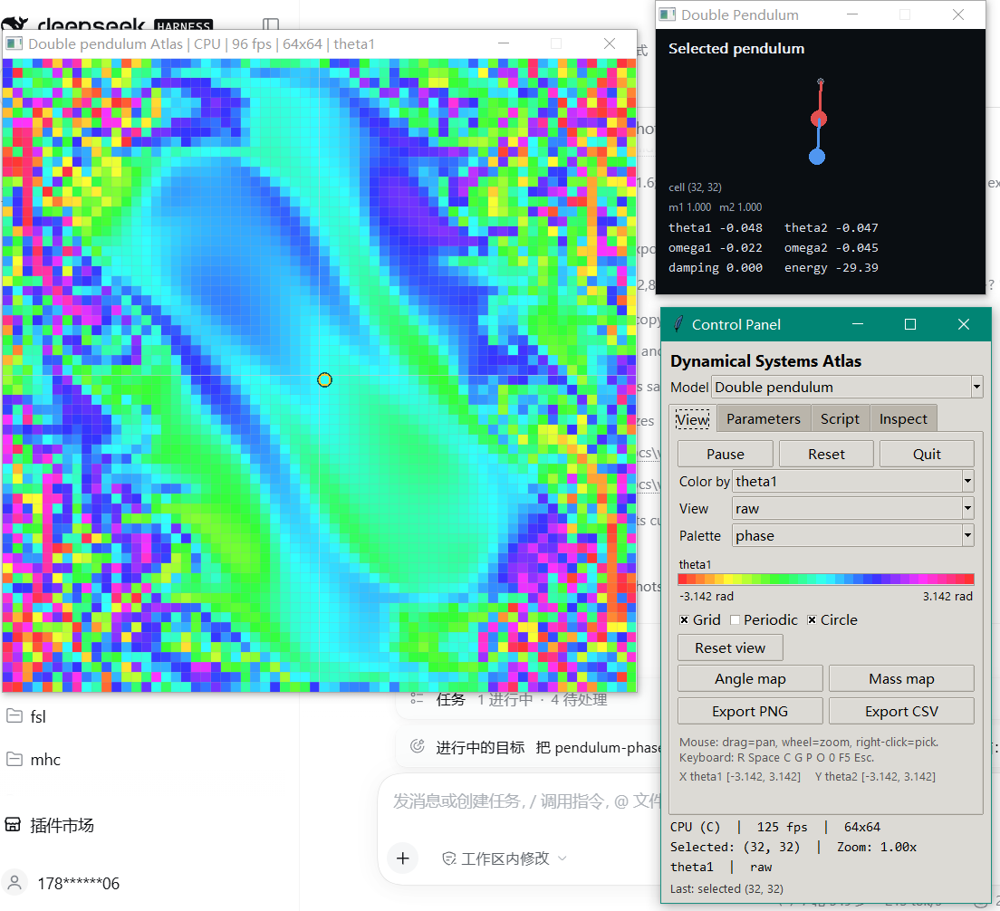
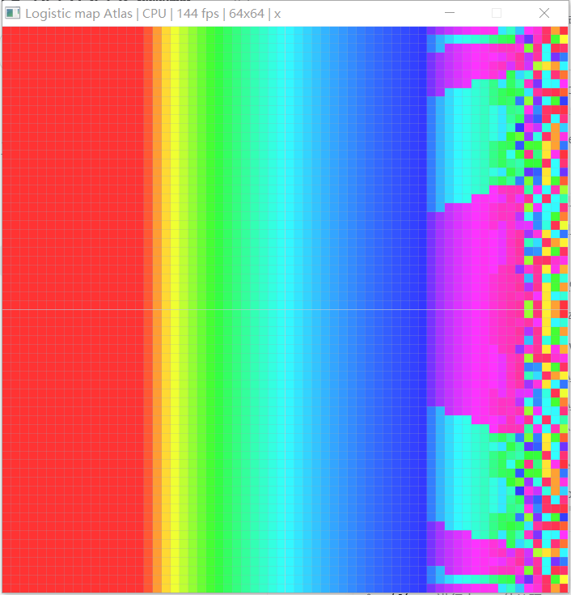
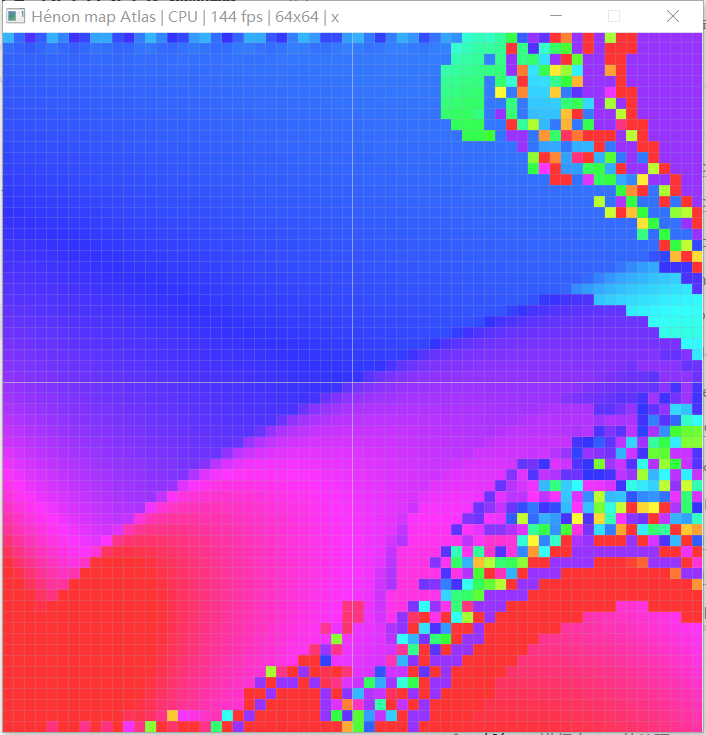
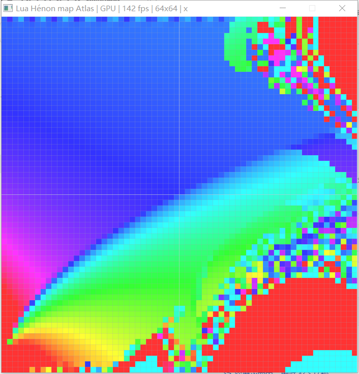
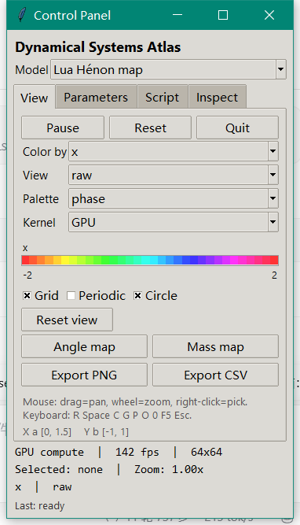
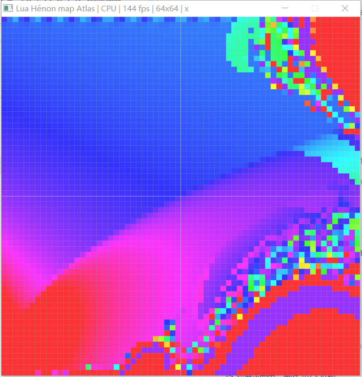
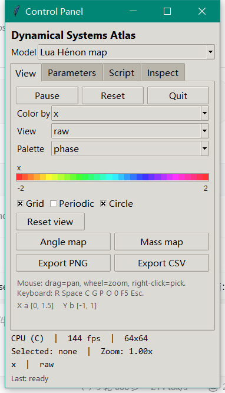
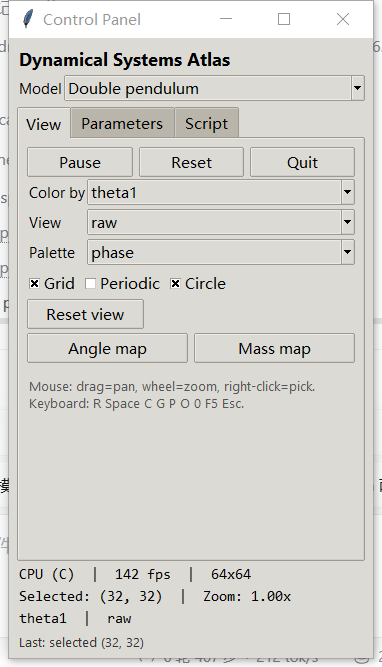
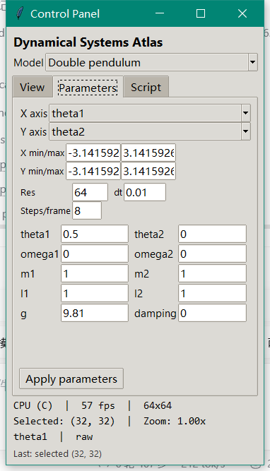
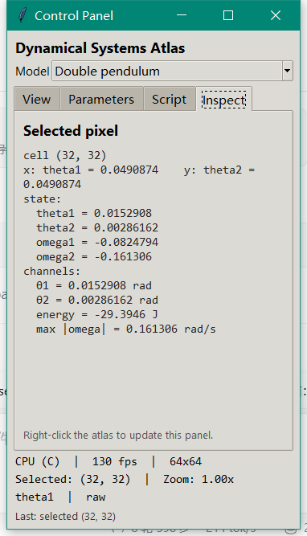

# 动力学系统地图实验箱 · 双摆 / Logistic / Hénon / Lua 表达式模型

一个 **二维参数/初值地图（2D map）** 实验框架：

> 选模型 → 选两个参数/初值作为 x/y → 每个像素积分 → 多通道观测量 →
> 后处理 + 调色板 → 右键选像素看轨道/状态。

三种内置模型和 Lua 自定义表达式模型共享同一套 Experiment/Atlas/View/Panel：

| 模型 | 类型 | 默认 x/y 轴 | 参数 | 通道 |
| --- | --- | --- | --- | --- |
| Double pendulum | ODE | θ1 / θ2 | θ1, θ2, ω1, ω2, m1, m2, l1, l2, g, damping | θ1, θ2, energy, omega_max |
| Logistic map | map | r / x0 | r, x0 | x, lyapunov, mean, |x| |
| Hénon map | map | a / b | a, b, x0, y0 | x, y, radius, |x| |
| Lua Hénon (custom) | Lua map | a / b | a, b, x0, y0 | x, y, radius, |x| |

双摆窗口只对双摆模型存在；Logistic/Hénon/Lua 自定义模型是“地图 + 参数面板”两窗口。



## 快速开始

```powershell
cd pendulum-phase
pwsh -File build.ps1
Expand-Archive .\dist\dp-phase-1.10.0.zip -DestinationPath .\dist\run -Force
.\dist\run\dp-phase\dp-phase.exe

# 直接打开某个模型
.\dist\run\dp-phase\dp-phase.exe /model logistic
.\dist\run\dp-phase\dp-phase.exe /model henon
.\dist\run\dp-phase\dp-phase.exe /model custom
```

发布物是解压即用的文件夹 + zip；Tcl/Tk 动态链接，不做单 exe/内嵌运行时：

```text
dp-phase/
  dp-phase.exe
  tcl86.dll / tk86.dll / libgcc_s_dw2-1.dll / zlib1.dll
  lib/tcl8.6, lib/tk8.6
  ui/panel.tcl
  experiments/experiment.lua
```

已验证“PATH 只剩系统目录、MINGW_ROOT 指向不存在目录”的干净副本可以启动面板。

## 内置模型 + Lua 自定义

### Double pendulum（示例 ODE）

状态 `[θ1, θ2, ω1, ω2]`，参数 `[θ1, θ2, ω1, ω2, m1, m2, l1, l2, g, damping]`。
x/y 可以是任意两个 eligible 参数：

- θ1/θ2：初值地图（Angle map 预设）；
- m1/m2：质量参数图（Mass map 预设）；
- l1/l2、damping、ω 等也可直接做轴。

物理验收仍覆盖静止能量、damping=0 能量守恒、C/Fortran 参考对照。

### Logistic map

`x ← r x (1-x)`，初值 `x0`：

- 默认轴 r/x0，r ∈ [0,4]，x0 ∈ [0,1]；
- 通道：
  - `x`：最终状态；
  - `lyapunov`：有限时间 Lyapunov 指数，`mean(log|r(1-2x)|)`；
  - `mean`：轨道平均；
  - `|x|`。
- 自检覆盖 r=2.5 的稳定不动点 1-1/r、r=4 时 λ≈ln 2。



### Hénon map

`x' = 1 - a x² + y`，`y' = b x`：

- 参数 a,b,x0,y0；默认轴 a/b；
- 通道 x、y、radius、|x|；
- 自检覆盖 a=1.4,b=0.3 的有界吸引子。



### Lua 表达式模型（M5a/M5b）

`experiment.lua` 里的 `M.custom` 定义 2 状态 map：

- `state = { "x", "y" }`；
- `step = { x = "1 - a*x*x + y", y = "b*x" }`；
- 参数 a,b,x0,y0，默认轴 a/b；
- channels 用表达式：`x`、`y`、`sqrt(x*x + y*y)`、`abs(x)`。

C 的 `expr.c` 在加载时把字符串编译成 **postfix bytecode**，每像素执行字节码；
**不逐像素调用 Lua**。自检将 custom 与内置 Hénon 的前 10 步逐值比较。

M5b 又加了 **GLSL 代码生成**：`expr_to_glsl()` 把 postfix 字节码转成 GLSL，
`custom_model_glsl()` 生成 compute shader，`gpu_compile_custom/gpu_run_custom` 编译并执行。
GPU 单格结果与 CPU 逐值匹配（双精度 CPU vs float GPU，容差 1e-5）。

**M6：GPU compute atlas 已接 GUI（自定义模型）**。View 页的 **Kernel** 可选 CPU/GPU：

- GPU 后端把整张 Atlas cells 上传，dispatch 表达式 compute，再读回 state/channels，
  交给现有 CPU colorize；
- 双摆/Logistic/Hénon 仍只支持 CPU；选择 GPU 会自动回退并提示；
- 标题/状态显示 GPU；CPU/GPU 结果在 2 步 atlas 测试中一致；
- GPU float 与 CPU double 在长时间混沌轨道上会分叉，这是预期。





当前限制：只支持 2 状态 map、无控制流/ODE；GPU 只对 Lua 自定义模型；
CPU/GPU 长时间混沌轨道会因精度分叉。





## 模型选择与面板

面板标题下是 **Model** 下拉框：

- 切换模型会重建参数 schema、轴、范围和通道；
- 双摆会重新创建右侧检查器，Logistic/Hénon/Lua 自定义不创建；
- 参数在 **Parameters** 页改，Apply 后重建，不需要 reload Lua；
- **Angle map / Mass map** 预设是双摆专用；在 map 模型上点它会切回双摆。
- Lua 自定义模型只有 `experiment.lua` 里存在 `M.custom` 时才出现。



**View**：Model、Color by、View（raw/gradient/range/variance）、Palette、Kernel CPU/GPU、颜色条、Grid/Periodic/Circle、Reset view、Angle/Mass 预设、Export PNG/CSV。

**Parameters**：X/Y 轴、范围、Res、dt、Steps/frame、模型参数、Apply parameters。
面板高度按屏幕自适应（1080p 下 620 客户区），双摆 10 个参数能完整显示。

**Script**：`experiments/experiment.lua`、Reload script（F5）。脚本现在同时提供 schema 元数据和调色板。

**Inspect**：右键选中像素后显示 cell、x/y 轴值、状态和通道值；map 模型没有专用窗口，这个页就是它的检查器。





## 颜色条、选中值与导出

- View 页底部有当前通道的颜色条，标签/单位/范围来自模型通道定义；
- 轴读数显示 `X name [min, max]  Y name [min, max]`；
- 右键点击地图，Inspect 页更新；
- Export PNG：把当前 CPU 颜色化的 atlas 写成 8-bit RGBA PNG；
- Export CSV：每格一行，列为
  `model,ix,iy,x_<axis>,y_<axis>,state_<...>,ch_<...>`；
- 导出目录是 exe 旁的 `exports/`，文件名带时间戳；面板 Last 显示完整路径；
- 没有文件选择对话框，PNG 只包含 atlas，不包含面板/叠加线。

## 通道与后处理

模型提供自己的通道范围/单位/是否循环；显示层统一处理：

| 后处理 | 计算 |
| --- | --- |
| raw | 原值，按模型范围映射 |
| gradient | 3×3 Sobel 幅值 |
| range | 3×3 极差 |
| variance | 3×3 标准差 |

gradient/range/variance 自动按当前画面 min/max 映射；角度差分使用 wrap_diff。

## Lua 现在负责什么

`experiments/experiment.lua` 现在同时提供**实验 schema 元数据**和调色板：

```lua
M.models.double_pendulum = {
    title = "Double pendulum",
    axes = { "theta1", "theta2" },
    params = {
        { name="theta1", label="θ1", unit="rad",
          default=0.5, min=-math.pi, max=math.pi, step=0.01, axis=true },
        ...
    },
    channels = {
        { name="energy", label="energy", unit="J",
          min=-50, max=50, cyclic=false },
        ...
    },
}
function M.schema(id) return M.models[id] end
```

- C 的 Model 仍拥有动力学/状态/step；Lua 只覆盖标题、参数 label/unit/range/default/axis、
  通道 label/unit/range 和默认轴。
- 名字必须匹配当前 Model；这不是任意字段/表达式模型。
- 面板改参数仍然不需要 reload；F5 重读 schema + palette，重建 atlas，并刷新面板。
- 参数值、用户轴在 F5 时保留；范围按 schema 更新/裁剪。
- 已实测把 θ1/θ2 改成 A1/A2 后 F5，参数页立即显示 A1/A2。

表达式模型、CPU/GLSL 代码生成是下一阶段 M5；当前不是任意公式 DSL。

## 代码结构

```text
src/model.h         通用 Model 接口（参数/状态/通道/回调）
src/model.c         模型注册表
src/model_dp.c      双摆 ODE
src/model_logistic.c Logistic map + Lyapunov
src/model_henon.c   Hénon map
src/expr.c/h        表达式 → postfix bytecode + GLSL 生成
src/model_custom.c/h Lua 表达式 2D map
src/experiment.c/h  模型无关的轴/范围/通道 schema + Lua metadata 应用
src/schema.h        Lua↔Experiment 的 schema 元数据
src/atlas.c/h       每像素 state+params、调用模型、通道、后处理、RGBA
src/app.c           窗口/帧循环/模型切换/选择/预设
src/gpu.c           OpenGL 4.3 上下文、动态 compute、GPU atlas、显示
src/phase_view.c    归一化 [0,1] 视图、pick、平移/缩放、格线/圆圈
src/panel.c         Tcl/Tk 宿主与 dp_action/dp_status/dp_query
src/png.c           最小 RGBA PNG 写入器（zlib）
ui/panel.tcl        四页动态面板 + Model 下拉 + Inspect
src/lua_hot.c       Lua 宿主 + palette/schema 桥
experiments/        experiment.lua：schema/表达式 + 调色板
src/selftest.c      CPU 100 项；含 GPU 的 115 项
```

## 验证

- `/selftest`：**100/100**
- `/gpu-selftest`：**115/115**
- 三个内置模型 + Lua 表达式模型 GUI 启动、面板切换、双摆检查器创建/销毁、自定义地图都实测；
- 详见 [docs/verification.md](docs/verification.md)，设计见 [docs/design.md](docs/design.md)。

## 已知边界 / 下一步

1. Lua 2D map 已生成 CPU 字节码和 GLSL，GPU atlas 已接自定义模型；还没有控制流/ODE 与全模型 GPU。
2. GPU compute atlas 目前只支持 Lua 自定义模型；双摆/Logistic/Hénon 走 CPU。
3. 地图/自定义模型没有独立窗口检查器；用面板 **Inspect** 页。
4. 没有文件选择对话框、实验保存/加载；导出固定到 exe 旁 exports/。
5. 能量通道范围固定 ±50 J；极端参数会饱和；PNG 不包含叠加线。
6. 没有 3D 切片/分岔连续化；目标是 2D 地图，不是 AUTO/MatCont 替代品。

## 仓库

- 分支：`three-windows`
- 自检：`dp-phase.exe /selftest`、`/gpu-selftest`
- 发布：`dist/dp-phase/`、`dist/dp-phase-1.10.0.zip`