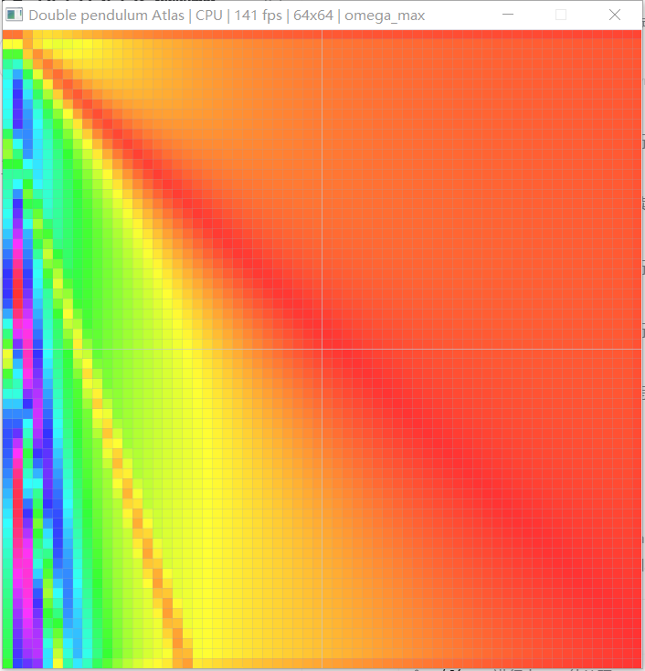

# 验证记录：二维动力学地图实验箱

本机：Windows 10，1920×1080，125% 缩放；MinGW.org GCC 6.3、gfortran 6.3、
Tcl/Tk 8.6.0、Lua 5.2、NVIDIA GTX 1650 Ti。

## 1. 构建

```text
[1/6] checking Tcl/Tk runtime
[2/6] embedding shaders (field, display, line, atlas)
[3/6] compiling C skeleton (16 objects)
[4/6] compiling Fortran kernel
[5/6] compiling resources
[6/6] linking (dynamic Tcl/Tk, static Lua/Fortran)
OK -> dist/dp-phase/dp-phase.exe (712,704 bytes)
      staged 9.9 MB
      dist/dp-phase-1.4.0.zip (3.6 MB)
```

| 项目 | 值 |
| --- | --- |
| exe | 712,704 B（GNU ld 的 PE 时间戳使每次链接的 SHA256 不同，不在这里固定） |
| zip | 约 3.5–3.7 MB（docs 改动会改变 zip 哈希，不在这里固定） |
| 解压 | 约 997 个文件，约 10 MB（含 docs） |
| 导入表 | KERNEL32/USER32/GDI32/OPENGL32/WINMM/MSVCRT + **tcl86.dll / tk86.dll** |
| 随包 DLL | tcl86.dll、tk86.dll、libgcc_s_dw2-1.dll、zlib1.dll |
| 脚本 | lib/tcl8.6、lib/tk8.6、ui/panel.tcl、experiments/double-pendulum.lua |

已从 `dist/dp-phase-1.4.0.zip` 解压到独立目录，`/selftest` 通过；另做了一次
“PATH 只有 C:\Windows\System32;C:\Windows、MINGW_ROOT 指向不存在目录”的干净副本启动，
三个窗口和面板正常。

## 2. 自检

```text
-- experiment / atlas
  [ok]   atlas creation
  [ok]   atlas cell preserves per-pixel masses
  [ok]   energy channel is finite
  [ok]   energy/range view colorizes
  [ok]   rest energy matches m g l
  [ok]   RK4 conserves energy for damping=0
...
selftest: 65 passed, 0 failed
```

`/gpu-selftest`（旧 GPU compute/显示回归 + 新增 CPU 测试）：**71/71**。
GUI 的采样已经不走旧 GPU compute；GPU 只负责 atlas RGBA 显示和线叠加。

## 3. 地图与通道

### 3.1 角度图（θ1/θ2，颜色 = 最终 θ1）


- 64×64，格线 + 选中圆圈；
- 右键选中中心格（32,32），双摆窗口同步；
- 颜色查找表来自外部 Lua 调色板。

### 3.2 质量图（m1/m2，颜色 = 局部 omega_max 敏感性）



- 先在参数页设 m1/m2 为轴、范围 0.2–3、固定 θ1=0.5、θ2=0；
- View = range（3×3 极差）；
- 显示的是局部敏感性，不是原始能量；
- 能量对质量是线性的，所以 energy+range 的 3×3 极差在内部为常数；这是物理上正确的，
  因此 mass 预设使用 omega_max + range。

### 3.3 参数页


- X/Y 轴 m1/m2；
- 范围 0.2–3；
- Res 64、dt 0.01、Steps/frame 8；
- 10 个参数两列布局，Apply parameters 生效；
- 改参数不 reload Lua。

### 3.4 检查器


显示 cell、m1/m2、最终 θ/ω、damping、energy。当前选中中心格，m1=m2=1，
damping=0，能量约 -29.39 J。

## 4. 面板交互

- 启动后默认 View 页：Color by theta1、View raw、Palette phase、Grid/Circle 开、Periodic 关；
- 点 **Mass map**：
  - 标题变为 `Double pendulum Atlas | CPU | ... | omega_max`
  - 面板 Color by=omega_max、View=range、Last=masses；
  - 参数页 X/Y=m1/m2、范围 0.2/3、theta1=0.5；
- 点 **Angle map** 回到 θ1/θ2；
- 右键选点后 Selected 更新，双摆窗口显示能量；
- 面板 Quit/标题栏 ×、双摆 ×、相空间 × 都正常退出（此前测过）。
- 键盘 Space/R/C/G/P/O/0/F5/Esc 在相空间窗口可用。

无 MinGW 的干净副本：

```text
title: Control Panel
title: Double Pendulum
title: Double pendulum Atlas | CPU | 144 fps | 64x64 | theta1
panel=True
```

## 5. 性能

- 64×64 角度图：**142–147 fps**（CPU 线程池，1–8 步/帧）；
- 质量图：约 100–144 fps；
- 500 步 64×64 离线渲染：几十毫秒；
- CPU 每步在 64×64 上约 2 ms（8 线程），UI 帧预算充足；
- 256×256 计算量约 16 倍，CPU 仍可运行但会明显变慢；GPU compute atlas 尚未接入 GUI。

## 6. 物理验收

- 静止能量：m1=m2=l1=l2=1，g=9.81，θ=0 → E=-29.43 J；
- damping=0、dt=0.001、2000 步：能量相对漂移 < 1e-3；
- 双摆 RK4 仍与 C 参考/Fortran 对照自检通过；
- 质量轴时每格参数独立存储，能量/敏感性使用该格的质量，不使用全局统一值。

## 7. 低分辨率锐利度

历史问题（场纹理 `GL_LINEAR` 放大）仍然保留修复：当前 atlas 纹理是 `GL_NEAREST`，
64×64 放大后是清晰方块。旧的 before/after 仍可参考：

| before | after |
| --- | --- |
|  |  |

## 8. 本次修掉的实现问题

| 问题 | 根因 | 修复 |
| --- | --- | --- |
| GUI atlas 黑屏、只有网格 | 没有调用 `gpu_set_res`，fullscreen VAO 为 0 | 在 build_modern 中创建 VAO |
| atlas 26 fps | 单线程 RK4 | 行带线程池，142 fps |
| post range 全红/无对比 | 固定 *res/span 缩放，线性场内部恒定 | 两遍自动 min/max；mass 预设改用 omega_max |
| 参数页被裁切 | 10 行单列 + 固定高度 | 两列参数 + 集成参数行 |
| Tcl 查询 axes/view 只有一个元素 | 返回字符串外层多了一对 {} | 返回不带外层 braces 的列表 |
| staging 14.9 MB / 嵌套 tcl8.6 | Copy-Item 目标已存在导致嵌套 | 先建目标目录，复制内容；stage 9.9 MB |
| 能量显示类型不匹配 | float[4] 传给 double[4] | 局部 double 转换 |

## 9. 已知边界

1. 模型仍只有内置双摆；没有第二个模型/表达式 DSL。
2. GUI 采样是 CPU；旧 GPU compute 只用于 selftest，不是 GUI 后端。
3. Lua 目前只提供调色板/meta；参数 schema 在 C。
4. 没有 colorbar、轴标签、单位、导出 CSV/PNG、保存实验。
5. 能量通道固定 ±50 J；极端质量/长度可能饱和。
6. 没有 3D 切片/滑块。
7. exe 未签名；zip 首次运行可能触发 SmartScreen。

## 10. 复现

```powershell
pwsh -File build.ps1
.\dist\dp-phase\dp-phase.exe
.\dist\dp-phase\dp-phase.exe /selftest
.\dist\dp-phase\dp-phase.exe /gpu-selftest

# 角度/质量图离屏
.\dist\dp-phase\dp-phase.exe /shot angle.bmp /res 64 /steps 300
.\dist\dp-phase\dp-phase.exe /shot mass.bmp /res 64 /steps 300 /axisx m1 /axisy m2 /channel omega_max /post range
```