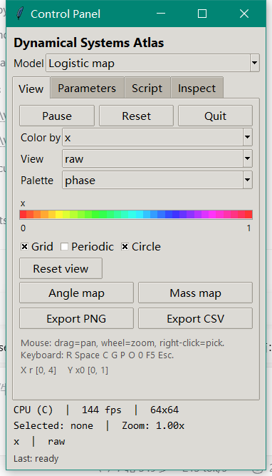
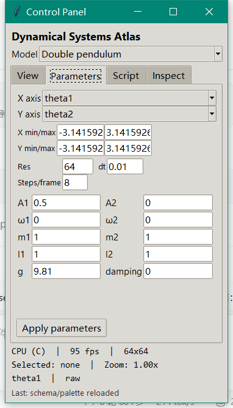
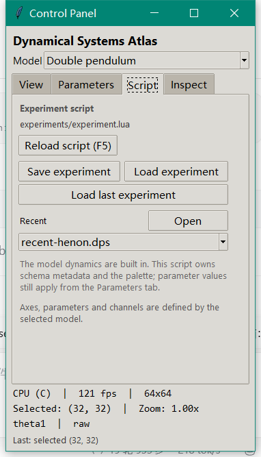

# 验证记录：三模型通用地图实验箱

本机：Windows 10，1920×1080，125% 缩放；MinGW.org GCC 6.3、gfortran 6.3、
Tcl/Tk 8.6.0、Lua 5.2、NVIDIA GTX 1650 Ti。

## 1. 构建

```text
[3/6] compiling C skeleton (24 objects)
[6/6] linking (dynamic Tcl/Tk, static C/Fortran)
OK -> dist/dp-phase/dp-phase.exe (809,984 bytes)
      staged 10.4 MB
      dist/dp-phase-1.13.0.zip (3.9 MB)
```

| 项目 | 值 |
| --- | --- |
| exe | 809,984 B |
| zip | 约 3.9 MB（docs 改动会改变 zip 字节数） |
| 导入表 | KERNEL32/USER32/GDI32/OPENGL32/WINMM/MSVCRT + tcl86.dll/tk86.dll（zlib 静态） |
| 随包 DLL | tcl86、tk86、libgcc_s_dw2-1、zlib1 |
| 脚本 | lib/tcl8.6、lib/tk8.6、ui/panel.tcl、experiments/experiment.lua |

（GNU ld 的 PE 时间戳使每次链接的 SHA256 不同，不固定哈希。）

## 2. 自检

```text
-- experiment / atlas
  [ok]   double-pendulum schema has named parameters
  [ok]   axes can be switched to masses
  [ok]   atlas cell preserves per-pixel masses
  [ok]   rest energy matches m g l
  [ok]   RK4 conserves energy for damping=0
-- map models
  [ok]   three models are registered
  [ok]   logistic r=2.5 converges to 1-1/r
  [ok]   logistic r=4 Lyapunov ~= ln 2
  [ok]   henon state stays bounded
  [ok]   logistic parameter map is non-uniform
-- Lua schema
  [ok]   schema hot reload parses
  [ok]   schema hot reload metadata
-- expressions / custom model
  [ok]   expression precedence/functions
  [ok]   custom model builds
  [ok]   custom init matches built-in Hénon
  [ok]   custom step matches built-in Hénon
  [ok]   GPU custom state matches CPU
  [ok]   GPU custom channels match CPU
  [ok]   GPU custom atlas matches CPU
-- experiment session
  [ok]   session save
  [ok]   session load
  [ok]   session axes/ranges roundtrip
  [ok]   session integration roundtrip
selftest: 117 passed, 0 failed
```

`/gpu-selftest`：**137/137**（117 CPU + 旧 GPU + 表达式/ODE/GPU atlas 回归）。
GUI 采样仍是 CPU；GPU 只负责 atlas RGBA 显示和线叠加。

## 3. 双摆三窗口


- 默认 θ1/θ2 角度图，64×64；
- 右键中心格，双摆检查器显示 cell、m1/m2、θ/ω、damping、energy；
- 参数页在 1080p 下完整显示 10 个参数（面板客户区 620）。


## 4. Logistic map


- 默认 r/x0 轴，r∈[0,4]，x0∈[0,1]；
- 每像素 200 步（离屏）/连续帧（GUI）；
- Color by = x 时是经典 Logistic 参数图：周期窗、混沌带、边界清晰；
- Color by = lyapunov 时 r=4 附近约 ln 2。

自检：

- r=2.5 从 x0=0.5 收敛到 1-1/r=0.6；
- r=4,x0=0.3,1000 步 → 状态在 [0,1]，λ≈0.693；
- atlas 的 lyapunov 通道在 r 方向非均匀。

## 5. Hénon map


- 默认 a/b 轴，a=1.4,b=0.3,x0=y0=0；
- Color by = x，64×64，连续帧；
- 自检：1000 步后状态有限、|x|<2、|y|<1，radius 通道有效。

## 6. 模型切换

面板标题下 Model 下拉：

- 启动默认 Double pendulum；
- 选 Logistic map：
  - 相空间标题变为 `Logistic map Atlas | CPU | ... | x`；
  - 双摆窗口消失；
  - Color by 变为 x，参数页只剩 r/x0；
  - Last: Logistic map；
- 选回 Double pendulum 会重新创建双摆窗口。

已用真实鼠标点击 combo popdown 的实测输出：

```text
after open: popdown
pop rect 804,456 301x67
titles after:
Control Panel
Logistic map Atlas | CPU | 122 fps | 64x64 | x
```

这里修掉了一个关键 bug：程序化销毁双摆窗口时 `WM_DESTROY` 会调用 closefn，
导致一次模型切换直接退出程序。现在 `pendulum_view_destroy` 先清空 closefn/keyfn。



## 7. 面板参数页


### 7.1 颜色条 / Inspect / 导出


- 颜色条来自当前调色板 LUT，标签/单位/范围来自模型通道；
- 轴读数 `X theta1 [-3.142, 3.142]  Y theta2 [-3.142, 3.142]`；
- 右键选中后 **Inspect** 页显示 cell、x/y、状态、通道；
- 这是 Logistic/Hénon 的检查器，不再需要独立窗口。


导出实测（双摆 64×64）：

```text
exports/atlas-20261024-011301.png  7,163 B  PNG signature 89 50 4E 47, 64×64
exports/atlas-20261024-011302.csv  567,991 B
model,ix,iy,x_theta1,y_theta2,state_theta1,state_theta2,...,ch_theta1,ch_theta2,...
```

PNG 是 zlib 压缩的最小 RGBA writer；CSV 列有 `x_`/`y_`/`state_`/`ch_` 前缀，
避免模型同名通道混淆。导出固定到 exe 旁 `exports/`，面板 Last 显示路径。

- X/Y 轴 combo；
- 范围、Res、dt、Steps/frame；
- 双摆 10 个参数两列布局；
- Apply parameters；
- 面板高度从 540 提到 620，解决模型行加入后 l2/g/damping 被裁切的问题。
- View 页加入颜色条、轴读数和 Export PNG/CSV；选中值移到独立 **Inspect** 页，避免 View 高度溢出。

## 8. Lua schema 与 F5

`experiments/experiment.lua` 现在同时提供 schema 元数据和调色板。启动/模型切换时
`defaults=1`，F5 时 `defaults=0`：

- C 参数/通道按 name 匹配；Lua 只能覆盖 label/unit/range/default/axis/cyclic，不能新增/重排；
- F5 重读脚本、重建 atlas，并调用 Tcl `rebuild_schema`；
- 参数值和用户轴保留，范围按新 schema 裁剪。

启动时参数页显示的 `θ1/ω1`（而不是 C 默认的 `theta1/omega1`）证明 schema 已生效。
F5 实测：把 Lua 的 `θ1/θ2` 改成 `A1/A2`，按 F5 后参数页立即变为：



`selftest` 新增 schema parser、metadata 应用、hot reload 解析/元数据测试。

## 9. Lua 表达式模型

`experiments/experiment.lua` 的 `M.custom` 定义 2 状态 map；C 的 `expr.c` 把
`step.x/step.y` 和 channel `expr` 编译成 postfix bytecode。

```text
/model custom
Model: Lua Hénon map
step: x' = 1 - a*x*x + y, y' = b*x
channels: x, y, sqrt(x*x+y*y), abs(x)
```

- 不逐像素调用 Lua；
- 面板 Model 下拉动态出现 Lua Hénon map；
- 自检把 custom 与内置 Hénon 的前 10 步逐值比较（更长步数会因混沌放大浮点差异）；
- 64×64 自定义模型仍约 140 fps。


## 10. GLSL 代码生成与 GPU 单格

`expr_to_glsl()` 从 postfix 字节码生成 GLSL，`custom_model_glsl()` 生成 compute shader；
`gpu_compile_custom()/gpu_run_custom()` 动态编译/dispatch。

```text
-- GPU expression codegen
  [ok]   GPU custom model builds
  [ok]   GLSL source generated
  [ok]   generated GLSL compiles
  [ok]   GPU custom dispatch
  [ok]   GPU custom state matches CPU
  [ok]   GPU custom channels match CPU
selftest: 137 passed, 0 failed
```

测试用单格 10 步 + 8×8 atlas 2 步 Hénon 表达式；单格容差 1e-5，atlas 2 步逐值一致。
GUI 的 **Kernel** 下拉可选 CPU/GPU（仅 Lua 自定义模型）：


标题/状态显示 GPU；双摆/Logistic/Hénon 选择 GPU 会回退 CPU 并提示。
CPU double 与 GPU float 在长时间混沌轨道上会分叉，这是精度差异。

## 11. 实验保存/加载

Script 页有 Save/Load experiment，原生对话框写 `.dps`。CLI 回归：

```text
shot: session_a.bmp 32x32 steps=20 kernel=cpu hash=8C388B1D
shot: session_b.bmp 32x32 steps=20 kernel=cpu hash=8C388B1D
SHA256 a/b 均为 DEB38453439C784A5DBBD45C0B7B68BC1175AE0D79DB8883074167576EFE6AD9
```

- 保存：模型、轴/范围、参数、res/dt/steps、通道/后处理/palette、Grid/Periodic/Circle、
  CPU/GPU 后端、视图中心/zoom；
- 加载：重建 Experiment/Atlas/检查器，应用 schema 后用文件覆盖，Tcl rebuild；
- custom 模型必须仍由 Lua 定义；GPU 失败回退 CPU。



## 12. 控制流表达式

`expr.c` 新增比较/逻辑/三元/`if(cond,a,b)`。CPU 用数值真值，GLSL 条件使用 bool；
自定义 `x_abs` 改为 `if(x < 0, -x, x)`，CPU/GPU 单格测试通过。

## 13. ODE 表达式

`type="ode"` 使用 `deriv={x=...,y=...}`；CPU 与 GLSL 都走 RK4，`dt` 来自实验。
自检用 `x'=y, y'=-x` 与解析解 `cos(1), -sin(1)` 对照；GPU 同一结果。

## 14. 性能

- 双摆 64×64：142–147 fps；
- Logistic/Hénon 64×64：140+ fps；
- 64×64 双摆每步约 2 ms（8 线程）；
- 256×256 CPU 仍可算，但约 16 倍成本，GPU compute 未接 GUI。

## 15. 本次修掉的问题

| 问题 | 根因 | 修复 |
| --- | --- | --- |
| 通用 Atlas 质量/颜色错误 | 把 double state/vals 用 memcpy 写进 float cells | 逐元素转换 |
| 模型切换后程序退出 | 销毁双摆窗口触发 closefn → app 退出 | destroy 前清空 closefn/keyfn |
| 模型下拉只显示 “Double” | models 列表里 title 未加花括号，Tcl lassign 截断 | 返回 `{id {title}}` |
| 参数页底部被裁 | 新增 Model 行占用高度 | 面板客户区 620；参数页完整 |
| 模型切换后双摆窗口不复现 | 只在 app_create 创建 pview | app_set_model 中按模型创建/销毁 |
| 颜色条 Tcl 报错 | ttk::canvas 不存在 | 改用经典 canvas |
| 轴读数/选中值不更新 | Tcl 双引号里 `[%.4g...]` 被当命令 | 用 `format {..}` + 分离 catch |
| 选中值控件路径写错 | `.sel.l` vs `.self.l` | 改为 Inspect 页 `.f.nb.insp.txt` |
| CSV 列名冲突 | x/y/state/channel 同名 | 加 `x_/y_/state_/ch_` 前缀 |
| Lua 脚本名与多模型不符 | 原 double-pendulum.lua | 改为共享 experiments/experiment.lua |

## 16. 已知边界

1. Lua 仍是 palette/meta，不是模型 DSL。
2. 只有三个内置模型，无表达式模型。
3. GUI 采样 CPU；GPU compute 未接。
4. Logistic/Hénon 只有面板 Inspect，没有独立窗口 inspector。
5. Lua 是 schema 元数据，不是表达式模型；不能新增参数字段或重排通道。
6. 没有文件选择对话框、实验保存/加载；PNG 只包含 atlas。
7. Hénon 未算 Lyapunov；map 的 Lyapunov 是有限时间平均。
8. 没有 3D 切片/连续化。

## 17. 复现

```powershell
pwsh -File build.ps1
.\dist\dp-phase\dp-phase.exe
.\dist\dp-phase\dp-phase.exe /model logistic
.\dist\dp-phase\dp-phase.exe /model henon
.\dist\dp-phase\dp-phase.exe /model custom
.\dist\dp-phase\dp-phase.exe /model custom /gpu
.\dist\dp-phase\dp-phase.exe /load session.dps
.\dist\dp-phase\dp-phase.exe /save session.dps
.\dist\dp-phase\dp-phase.exe /selftest
.\dist\dp-phase\dp-phase.exe /gpu-selftest

# 离屏
.\dist\dp-phase\dp-phase.exe /shot logi.bmp /model logistic /steps 200 /channel lyapunov
.\dist\dp-phase\dp-phase.exe /shot henon.bmp /model henon /steps 200 /channel radius
```