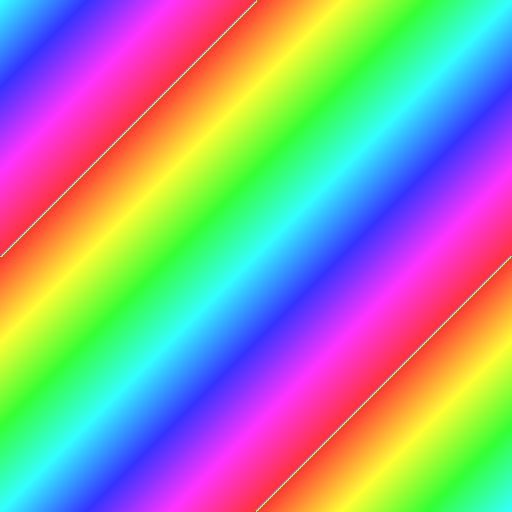
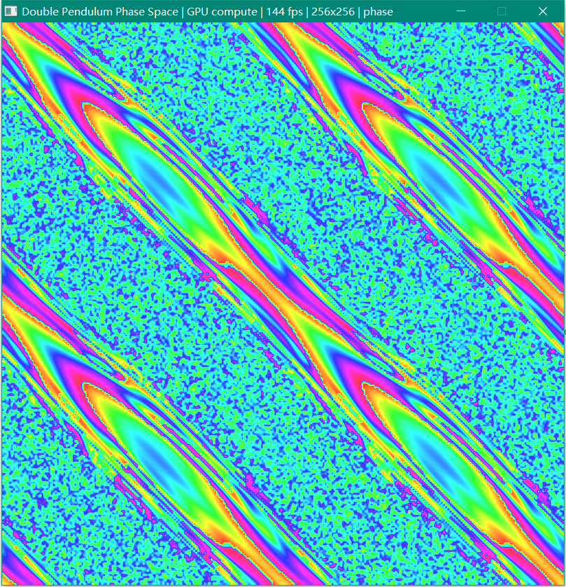

# 验证记录

以下全部是本机实跑结果。构建命令、运行命令和输出都可复现。

## 1. 环境

| 项 | 值 |
| --- | --- |
| 系统 | Windows 10 19045（1920×1080，125% DPI） |
| 编译器 | MinGW.org GCC 6.3.0 / GNU Fortran 6.3.0（32 位） |
| Lua | 5.2.0（`C:\MinGW\lib\liblua.a`，静态链入） |
| GPU | NVIDIA GeForce GTX 1650 Ti，驱动报告 OpenGL 4.6，程序请求 4.3 core |
| 构建入口 | `pwsh -File build.ps1` |

## 2. 构建

```
=== Double Pendulum Phase Space ===
toolchain: C:\MinGW
[1/5] embedding shaders
      field.comp 2,794 B, display 761 B
[2/5] compiling C skeleton
      11 C objects
[3/5] compiling Fortran kernel
[4/5] compiling resources
[5/5] linking (static)
OK -> ...\dist\dp-phase.exe  (269,312 bytes)

--- import table audit ---
  [ok]   GDI32.dll
  [ok]   KERNEL32.dll
  [ok]   msvcrt.dll
  [ok]   OPENGL32.DLL
  [ok]   USER32.dll
  [ok]   WINMM.DLL

--- selftest ---
...
selftest: 36 passed, 0 failed

--- gpu selftest ---
...
selftest: 41 passed, 0 failed

build complete.
```

* `dist/` 里只有一个文件：`dp-phase.exe`（269,312 字节）。
* SHA-256：`7B136AE5BB9B3C5AA81DCB42C750364D8CCD1D6C7BB220144D039F7386EA0D15`。
* 构建脚本在链接后检查导入表，出现白名单外的 DLL 会直接失败。

## 3. 导入表

```
DLL Name: GDI32.dll
DLL Name: KERNEL32.dll
DLL Name: msvcrt.dll
DLL Name: OPENGL32.DLL
DLL Name: USER32.dll
DLL Name: WINMM.DLL
```

全部是 Windows 自带组件。没有 `raylib.dll`、`lua52.dll`、`libgfortran-3.dll`、
`libgcc_s_*.dll`、`libwinpthread-1.dll` 或 VC 运行库。

## 4. 自测

```
.\dist\dp-phase.exe /selftest      -> selftest: 36 passed, 0 failed
.\dist\dp-phase.exe /gpu-selftest  -> selftest: 41 passed, 0 failed
```

关键项：

```
-- Fortran kernel
  [ok]   one step matches C reference (max 2.373e-007)
  [ok]   ten steps match C reference (max 3.246e-007)
  [ok]   1-thread and 4-thread bands are bitwise identical
-- CPU timing
  [info] 256x256 x 1 step: 8.41 ms, 7.79 Mcell-steps/s, 8 threads
-- Lua hot logic
  [ok]   defaults.res = 256
  [ok]   defaults.range = 4*pi
  [ok]   hot.palette returns 3072 bytes
  [ok]   phase palette midpoint is cyan (51,255,255)
  [ok]   tick(0.05) = 0 (below dt)
  [ok]   tick(0.06) = 1 (crosses dt=0.1)
  [ok]   key R -> reset
  [ok]   key SPACE -> pause
  [ok]   broken reload is rejected
  [ok]   old Lua state survives a rejected reload
  [ok]   reload adopts a new script (res=128)
-- GPU compute pipeline
  [info] GL_VERSION  = 4.3.0 NVIDIA 596.21
  [info] GL_RENDERER = NVIDIA GeForce GTX 1650 Ti/PCIe/SSE2
  [ok]   OpenGL 4.3 core + compute shader compiled
  [ok]   GPU one step matches C reference (max 3.720e-007)
  [ok]   3 substeps in one dispatch == 3 separate dispatches (bitwise)
  [ok]   field image matches CPU mapping (max 5.960e-008)
  [ok]   offscreen FBO draw + readback produced a non-black frame
  [info] GPU 256x256 x 1 step: 0.161 ms, 405.9 Mcell-steps/s
```

`/selftest` 覆盖：角度归一化、场值公式/NaN、C 参考与 Fortran 单步/十步、
线程数确定性、Lua 契约与热重载、BMP 头与像素布局、CPU 单步耗时。
`/gpu-selftest` 在此基础上再测：4.3 core 创建、两个着色器编译、GPU 与 C 参考的一步同步、
一次 dispatch 多子步与多次 dispatch 的逐位一致、R32F 场值与 CPU 公式一致、离屏 FBO 绘制。

## 5. 跨内核对比（`/shot`）

`/shot` 对 GPU 模式先 `glGetBufferSubData` 取回状态，再用与 CPU 完全相同的 C 着色公式出图，
因此比较的是**状态**，不掺入 R32F 纹理的舍入。

| 步数 | 不同像素 | 占比 | 最大通道差 | 平均通道差 |
| --- | --- | --- | --- | --- |
| 0 | 0 / 65536 | 0.000% | 0 | 0 |
| 1 | 1 / 65536 | 0.002% | 1 | 0.000015 |
| 5 | 12 / 65536 | 0.018% | 1 | 0.000183 |
| 10 | 34 / 65536 | 0.052% | 2 | 0.000610 |
| 20 | 483 / 65536 | 0.737% | 204 | 0.033813 |
| 40 | 6,250 / 65536 | 9.537% | 204 | 0.888275 |
| 80 | 25,643 / 65536 | 39.128% | 204 | 16.505615 |
| 120 | 40,232 / 65536 | 61.389% | 204 | 31.769562 |

0 步时 CPU/GPU 的 `/shot` 哈希都是 `DC8270B2`，BMP 逐字节相同——
这验证了初始网格、SSBO 上传/取回、场值和 LUT 索引全部对齐。
之后的分叉是 float32（GPU）与 double（Fortran）在混沌系统里的必然结果：
20 步左右单格轨迹越过分辨率，随后指数放大。大尺度结构仍然一致：




## 6. 显示路径

同一时刻、512×512 窗口、0 步：

| 路径 | 与 GPU 现代路径的差异 |
| --- | --- |
| CPU 计算 + 现代 shader | 0 像素（逐字节相同） |
| CPU 计算 + 兼容固定管线 | 58,082 像素（22.157%），平均 1.54/255，最大 204 |

现代路径是“R32F 场纹理 + 1024×1 调色板”两段线性采样；兼容路径是“CPU 已着色的 RGBA 纹理”
一次线性放大。结构、颜色、方向完全一致，差异来自两段采样与一段采样的插值顺序不同。
兼容路径的边缘用 `GL_CLAMP_TO_EDGE`（GL ≥ 1.2），没有白边。

## 7. 实际窗口

```
window 809x838  client 803x803
title: Double Pendulum Phase Space | GPU compute | 144 fps | 256x256 | phase
```

客户区 803×803（正方形），窗口外框的额外高度来自标题栏和边框。
两次相隔 1.2 s 的桌面截图有 94.9% 像素不同，说明相空间确实在持续演化。



热逻辑改调色板的示例（把 `hot.lua` 放到 exe 同目录，改 `M.scheme = "ember"`、`res = 192`）：


## 8. 按键

在真实窗口里用 `PostMessage(WM_KEYDOWN)` 逐个按键，读标题栏：

```
start:  Double Pendulum Phase Space | GPU compute | 144 fps | 256x256 | phase
K:      Double Pendulum Phase Space | Fortran CPU | 144 fps | 256x256 | phase
K:      Double Pendulum Phase Space | GPU compute | 144 fps | 256x256 | phase
SPACE:  Double Pendulum Phase Space | GPU compute | 144 fps | 256x256 | paused
C:      Double Pendulum Phase Space | GPU compute | 144 fps | 256x256 | paused
R:      Double Pendulum Phase Space | GPU compute | 144 fps | 256x256 | paused
```

`K` 的来回切换验证了 GPU→CPU 的 `glGetBufferSubData` 取回和 CPU→GPU 的上传/刷新路径。

## 9. 热重载

exe 同目录放一份 `hot.lua`（ember / 192），启动后把文件改成 ice / 256，再发 `F5`：

```
before: Double Pendulum Phase Space | GPU compute | 144 fps | 192x192 | ember
after:  Double Pendulum Phase Space | GPU compute | 144 fps | 256x256 | ice
```

分辨率变化时重载会重建 `Sim`、GPU 的 SSBO/场纹理，并重新读调色板和标题；
失败时保留旧状态（自测里的 `broken reload is rejected` / `old Lua state survives` 覆盖）。

## 10. 性能

| 内核 | 规模 | 单步耗时 | 吞吐 |
| --- | --- | --- | --- |
| GLSL compute（GTX 1650 Ti） | 256×256 | 0.14–0.17 ms | 约 400–470 Mcell-steps/s |
| Fortran（8 线程） | 256×256 | 7.7–9.4 ms | 约 7.0–8.5 Mcell-steps/s |

CPU 数据随机器负载有 ±20% 波动（实测 6.8–10.7 ms）。GPU 约快 50–65 倍，
所以默认走 GPU；Fortran 回退按真实时间 10 步/秒推进，帧内上限 4 子步。

## 11. 开发中修掉的真实缺陷

| 现象 | 根因 | 修法 |
| --- | --- | --- |
| `/selftest` 不打印、直接开窗口 | 参数解析在每个 token 后又 `++p`，吃掉了下一个 token 的首字符（`/selftest` → `selftest`） | 去掉多余的 `++p` |
| GPU 自测在隐藏窗口读回全黑 | 隐藏窗口的默认帧缓冲不可读 | 自测改用离屏 FBO（`gpu_capture_offscreen`） |
| F5 后 `host.kernel` 读到已释放内存 | reload 用临时 `LuaHot` 建状态，host 闭包 upvalue 指向临时结构 | host upvalue 固定指向稳定的 `LuaHot`，用 `build_state` 原地换 `lua_State` |
| F5 后第一帧报 `hot.params must return 8 numbers` | `lua_hot_reset` 在 0 结果的 `lua_pcall` 后又 `lua_pop(L,1)`，把 Lua 栈顶打成负数 | 去掉多余的 pop |
| 兼容路径四周一圈白边 | 线性过滤 + `GL_CLAMP` 采到边界外 | GL ≥ 1.2 用 `GL_CLAMP_TO_EDGE` |
| MinGW 老头文件没有 `WM_DPICHANGED` / `GL_TEXTURE0` / `GL_CLAMP_TO_EDGE` | 工具链的 `windows.h` / `gl.h` 太旧 | 在 `platform.c` / `gl43.h` 里加守卫式定义 |
| Fortran 内核只有约 1 Mcell-steps/s | `deriv` 和 `fsincos` 没有内联，每格 16 次函数调用 + 16 次 msvcrt sin/cos（单次约 115 ns） | `-finline-limit=4000`、手工查表 sincos、和差化积（每阶段 2 次查表） |
| 0 步时 CPU/GPU 的 `/shot` 哈希不同 | 之前读 R32F 场纹理，半/浮点舍入影响个别 LUT 索引 | GPU 模式改为取回状态，用同一套 CPU 公式出图 |

## 12. 复现

```powershell
cd pendulum-phase
pwsh -File build.ps1

.\dist\dp-phase.exe /selftest
.\dist\dp-phase.exe /gpu-selftest
.\dist\dp-phase.exe /shot .\build\cpu0.bmp /cpu /steps 0
.\dist\dp-phase.exe /shot .\build\gpu0.bmp /gpu /steps 0
.\dist\dp-phase.exe /shot .\build\cpu120.bmp /cpu /steps 120
.\dist\dp-phase.exe /shot .\build\gpu120.bmp /gpu /steps 120
.\dist\dp-phase.exe /capture .\build\win.bmp /gpu /steps 120 /size 512
```

`/shot` 输出末尾带场值 FNV-1a 哈希；BMP 可直接用任意看图软件打开。
仓库里的截图由 `/capture` 和真实窗口抓屏生成，没有后期处理（只做了 BMP→PNG 转码）。

## 13. 已知限制

* **GPU/CPU 长期不一致**是设计取舍，不是 bug；需要一致时用 `/cpu`。
* **兼容路径**只验证了 NVIDIA 的 compatibility context（GL 4.6）；
  真正的 GL 1.1 软件渲染器上纹理会回退到 `GL_CLAMP`，边缘可能有 1 像素差。
* **分辨率**上限 1024，下限 32；Lua 写超范围会被夹取。
* **只有 32 位构建**：受 MinGW.org 工具链限制；`-msse2` 是硬要求。
* 正常帧不回读 GPU；切内核、截图、自测会同步回读，属于预期开销。