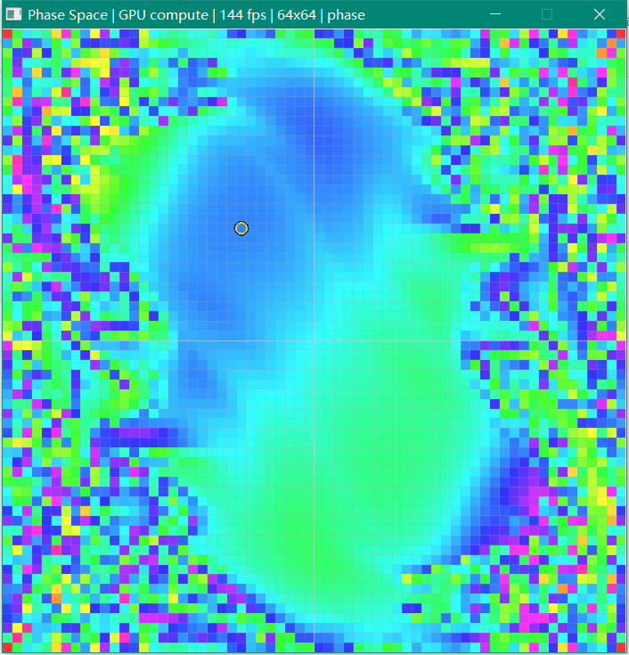
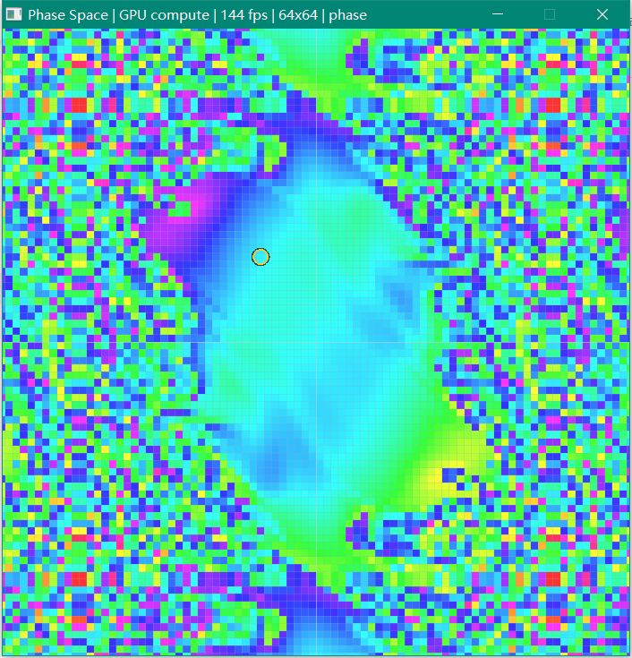
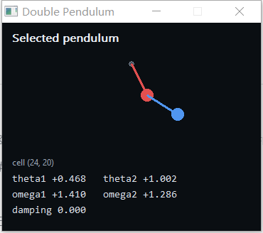
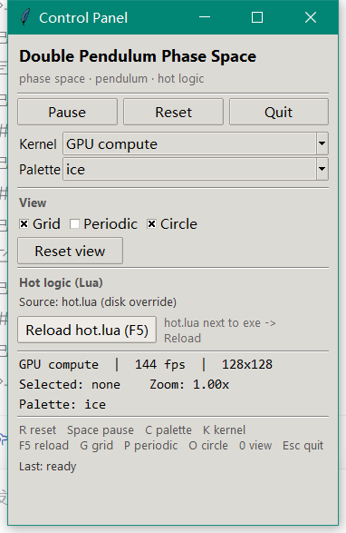

# 验证记录

以下全部是本机实跑结果。构建命令、运行命令和输出都可复现。

## 1. 环境

| 项目 | 值 |
| --- | --- |
| 系统 | Windows 10，1920×1080，125% 缩放 |
| C | MinGW.org GCC 6.3.0（32 位） |
| Fortran | gfortran 6.3.0 |
| Lua | 5.2.0（静态 `liblua.a`） |
| Tcl/Tk | 8.6.0（`tcl86.dll` 1,753,077 B，`tk86.dll` 1,692,530 B；脚本树 3.2 MB + 1.5 MB） |
| GPU | NVIDIA GeForce GTX 1650 Ti，GL 4.3 |
| 构建 | `pwsh -File build.ps1` |

## 2. 构建结果

```text
[1/6] packaging Tcl/Tk runtime
      981 files, 7.8 MB
[2/6] embedding shaders
      field.comp 2,794 B, display 1,427 B
[3/6] compiling C skeleton
      15 C objects
[4/6] compiling Fortran kernel
[5/6] compiling resources
[6/6] linking (static)
OK -> ...\dist\dp-phase.exe  (8,929,280 bytes)
```

导入表审计：

```text
KERNEL32.dll  USER32.dll  GDI32.dll  OPENGL32.dll  WINMM.dll  msvcrt.dll
```

没有 raylib、lua52.dll、libgfortran/libgcc DLL、VC 运行库，也没有 **tcl86.dll / tk86.dll**
的链接期导入；Tcl/Tk 是运行时从 exe 的 RCDATA 1003 解包后动态加载的。

```text
SHA256  ACBFD38CC882F2066D03A0B9963103D58DCA2282838957C9F38A4C4E07FDAF65
size    8,929,280 B
```

`dist/` 里只有 `dp-phase.exe`。

## 3. 自检

```text
--- selftest ---
...
-- phase view math
  [ok]   zoom 1 shows the whole range
  [ok]   screen centre maps to world origin (within 1 px)
  [ok]   centre pick -> centre cell
  [ok]   top-left pick -> (0,0)
  [ok]   bottom-right pick -> (res-1,res-1)
  [ok]   wheel zoom keeps the cursor world point fixed
  [ok]   drag right moves the view left
  [ok]   non-periodic view rejects a pick outside the field
  [ok]   periodic view wraps a pick outside the field
  [ok]   grid + selection circle produce overlay vertices
  [ok]   grid and circle off -> no overlay
  [ok]   grid only -> grid vertices
  [ok]   circle without a selection -> no overlay
...
  [ok]   hot.status -> running / phase (paused=0 scheme=phase)
  [ok]   hot.set_scheme(ember) is reflected by status
  [ok]   unknown palette is rejected
  [ok]   palette restored to phase
...
  [ok]   reload adopts a new script (res=128)
...
selftest: 53 passed, 0 failed

--- gpu selftest ---
  [ok]   field texture uses GL_NEAREST (sharp pixels)
...
  [info] GPU 256x256 x 1 step: 0.166 ms, 395.0 Mcell-steps/s
selftest: 59 passed, 0 failed
```

CPU 计时示例：`256x256 x 1 step: 7.45 ms, 8.79 Mcell-steps/s, 8 threads`；数值随系统负载波动。
当前 `lua/hot.lua` 的配置是 64×64 / 2π / dt 0.01 / damping 0 / max_steps 8，测试对配置做了
范围检查，不写死 256。

## 4. 相空间视图

### 4.1 64×64 锐利度

根因和修复见 [design.md](design.md#81-低分辨率模糊的根因)。修复前：


修复后：


两次都是 64×64 场，修复后每个格子有清晰边界；格线是叠加层，不会改变场纹理的过滤。

实拍（64×64，格线 + 选中圆圈）：



### 4.2 格线 / 周期 / 圆圈

- G 关闭格线：相空间只剩色块；
- P 打开周期视图，缩小到 0.76× 后相空间按周期平铺，没有黑边：



- O 关闭圆圈：黄色选中圆圈消失，便于看完整图；
- 以上三项都同时有面板控件和 G/P/O 快捷键；面板的 checked 状态由 `dp_status` 拉取。

### 4.3 拖拽、滚轮、右键

- 左键从 (350,350) 拖到 (470,410)，场和选中圆圈一起平移；非周期视图移出基础范围后出现
  背景色（这是预期，周期视图则平铺）；
- 滚轮以光标为中心缩放：自检的 “wheel zoom keeps the cursor world point fixed” 通过；
  周期截图状态为 `Zoom: 0.76x`；
- 右键中心 → cell (32,32)；右键 (24,20) → 双摆窗口显示对应 θ/ω。窗口标题/面板同步显示
  `Selected: (24, 20)`。

## 5. 三个窗口

| 窗口 | 外框 | 客户区 | 位置 |
| --- | --- | --- | --- |
| Phase Space | 706×735 | 700×700（正方形） | (19,48) |
| Double Pendulum | 370×328 | 364×294 | (740,16) |
| Control Panel | 382×587 | 364×540 | (740,355) |


三个都是独立顶层窗口；没有把双摆/面板画进相空间窗口。双摆窗口：



## 6. 面板控件

实拍：


逐项验证（键盘与面板走同一个 `app_do_action`）：

| 操作 | 结果 |
| --- | --- |
| Space / 面板 Pause | 按钮变 `Resume`，`Last: pause toggled` |
| 鼠标点面板 Pause | 变回 `Pause`，仿真继续 |
| C / 面板 Palette | `phase → ember`，面板下拉和状态行同步 |
| K / 面板 Kernel | `GPU compute → Fortran CPU`，标题/状态同步 |
| G / P / O | 面板勾选状态、相空间叠加层同步 |
| Reset view / 0 | 回到 1.00×、中心 |
| Reload / F5 | 见下一节 |
| Quit / 标题栏 × | 进程退出 |

面板的 Pause/Resume 点击是实际鼠标事件，不只是键盘路径。

## 7. 热重载

默认（无磁盘 hot.lua）：面板显示 `Source: embedded (RCDATA)`。

把改过的 `hot.lua` 放到 `dist\dp-phase.exe` 旁边后启动：

```text
title before: Phase Space | GPU compute | 144 fps | 128x128 | ice
Source:        hot.lua (disk override)
```

把磁盘脚本改成 96×96/ember，点面板的 `Reload hot.lua (F5)`：

```text
title after:  Phase Space | GPU compute | 144 fps | 96x96 | ember
Panel last:   hot.lua reloaded (disk)
```



坏脚本会保留旧 Lua 状态（自检 `old Lua state survives a rejected reload`）；
面板的 `Last:` 显示错误。

## 8. 退出路径

```text
panel Quit button  -> exited 0
panel WM_CLOSE     -> exited 0
pendulum WM_CLOSE  -> exited 0
phase WM_CLOSE     -> exited 0
```

## 9. 单 exe / 内嵌 Tcl/Tk

把 `%TEMP%\dp-phase-tcl86-8.6.0` 整个删掉，并把 `MINGW_ROOT` 指向不存在的
`C:\NoSuchTclDir`，启动 exe：

```text
title: Control Panel
title: Double Pendulum
title: Phase Space | GPU compute | 144 fps | 64x64 | phase
panel: True
runtime dir: True
981
```

即：没有工具链、没有缓存时，程序从 exe 解出 981 个文件到 TEMP 并显示面板。
正常桌面会优先用 `%LOCALAPPDATA%\dp-phase\tcl86-8.6.0`。解包目录只是缓存，
不是 `dist` 的外部依赖。

## 10. CPU / legacy 路径

```text
dp-phase.exe /capture legacy64.bmp /cpu /legacy /res 64 /steps 0 /size 512
capture: ... 512x512 steps=0 kernel=cpu legacy=1 renderer=...
```

legacy 固定管线 + CPU 场，场纹理 NEAREST，64×64 的方块边界仍然清晰；格线/边框正常。
（测试时另存了 `legacy64.png`，未入库。）

## 11. 性能

| 路径 | 分辨率 | 时间/步 | 吞吐 |
| --- | --- | --- | --- |
| GPU compute | 256×256 | 约 0.14–0.17 ms | 约 400–470 Mcell-steps/s |
| Fortran 8 线程 | 256×256 | 约 7–8 ms | 约 8.5–9.5 Mcell-steps/s |

相空间窗口在 64×64 / 2π 下稳定 144 fps（vsync 上限）；面板每 250 ms 拉一次状态，
不阻塞 GL。首次启动解包约 7.8 MB，之后走缓存。

## 12. 本次修掉的缺陷

| 现象 | 根因 | 修复 |
| --- | --- | --- |
| 64×64 看起来糊 | 场纹理 `GL_LINEAR` 放大 | 改 `GL_NEAREST`（现代 + legacy） |
| 双摆窗口白屏、标题空 | `BitBlt` 前把旧 1×1 位图选回 mem DC，复制的是空位图；标题设置/重绘时序也不稳 | 先 `BitBlt` 再 `SelectObject(old)`；显式 `SetWindowText` + `InvalidateRect` |
| 面板脚本报 `bad window path name ".f.hot"` | 脚本引用了没创建的父 frame | 改为 `.f.hot_src` / `.f.hot_row` |
| 面板不出现，Tcl_Init 找不到 init.tcl | 只设了 Win32 环境变量，MinGW `getenv` 看不到；且 LOCALAPPDATA 在沙箱不可写 | `_putenv` 同步 CRT；LOCALAPPDATA 失败后回退 TEMP |
| 面板首次不出现 | Tcl/Tk 运行时没有随 exe 分发 | 981 文件归档 + 解包 + 动态加载 |

## 13. 已知限制

- 面板第一次启动要解包约 7.8 MB；之后走缓存。
- 面板固定高度按工作区 clamp；很矮的屏幕需拉大面板。
- GPU/Fortran 舍入不同；默认 GPU。
- legacy 固定管线没有现代路径的视图 uniform 性能。
- exe 未签名，Windows 首次运行可能出现 SmartScreen 提示。

## 14. 复现命令

```powershell
# 构建 + 自检
pwsh -File build.ps1

# 只构建
pwsh -File build.ps1 -NoTest

# 单项自检
.\dist\dp-phase.exe /selftest
.\dist\dp-phase.exe /gpu-selftest

# 64x64 离屏截图（CPU/legacy）
.\dist\dp-phase.exe /capture out.bmp /cpu /legacy /res 64 /steps 0 /size 512

# 交互
.\dist\dp-phase.exe
```